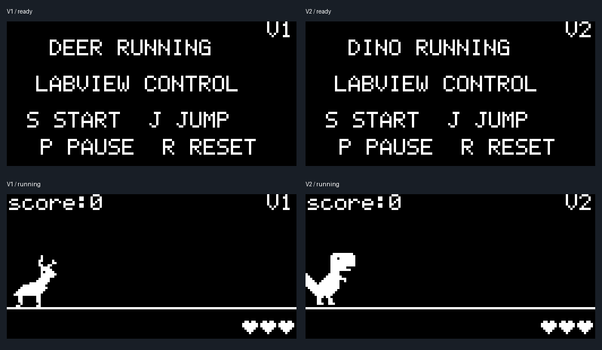

# SSD1306 显示修正

用户照片中旧版小鹿 V1 已显示就绪页，但屏幕左侧有异常亮线，V1 与底部 R RESET 重叠。用户确认 OLED 驱动为 SSD1306。

旧驱动 OLED_SetCursor 无条件 X+=2，并注明用于 1.3 英寸屏。此偏移不适用于该 SSD1306：逻辑第零列应直接写控制器第零列。现取消偏移，使 128 列帧缓冲与屏幕一一对应；初始化时先清屏、更新显存，再发送显示开启命令，避免刚上电时显示未初始化内容。SSD1306 的页/列寻址依据 [Solomon Systech 数据手册](https://files.waveshare.com/upload/a/af/SSD1306-Revision_1.1.pdf) 第 10.1.1–10.1.3 节。

版本号由 (102,56) 改为 (114,0)，6×8 字体、右侧留两像素。它在就绪、运行、暂停及结束画面共用绘制路径。血量图标原先从 y=6 开始，会与新的版本号区域相交，因此移到 y=56 的右下角；结束画面操作提示在左侧，不覆盖血量。

## 验证

新增 tests/test_oled_display.py 编译实际 OLED 初始化/绘图代码、游戏绘制代码和字体，只有 GPIO/I2C 写入在主机测试编译时以弱符号替换为控制器显存模型。测试未在生产代码加入专用接口。模型从非零显存启动，检查完整清屏、点亮顺序、逻辑/硬件帧缓冲一致、就绪页操作文字、运行页版本号及血量图像。

回归修正前两版均失败，修正后通过。完整 python tools/verify.py：199984 核心断言无失败，串口处理 PASS，消抖 23 项 PASS，Python40项通过。三个 ARMCC 固件构建成功，Boot12344字节，应用各19120字节，均在分区内。新版实屏结果仍待复烧验证。

以下预览来自测试程序导出的真实帧缓冲，并非开发板照片：

## 烧录

在 STM32CubeProgrammer 对目标板执行全片擦除，选择 releases/2026-10-15/factory_deer.hex，启用 Verify programming 后开始烧录。BOOT0置低，烧录校验成功后按复位键。由于 Bootloader 和应用共用的显示驱动都已变化，本次用合并 HEX 可同时更新两者。此操作会重置旧升级状态；以后的日常游戏升级仍发送应用 BIN。

检查就绪页左边缘是否干净、V1是否独立位于右上角；进入游戏后检查血量在右下角。未代替实物 LoRa 或真实掉电验收。
